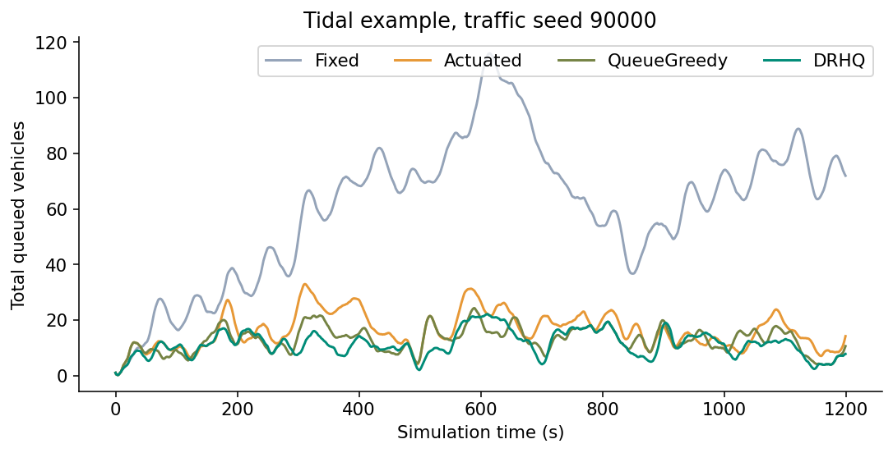
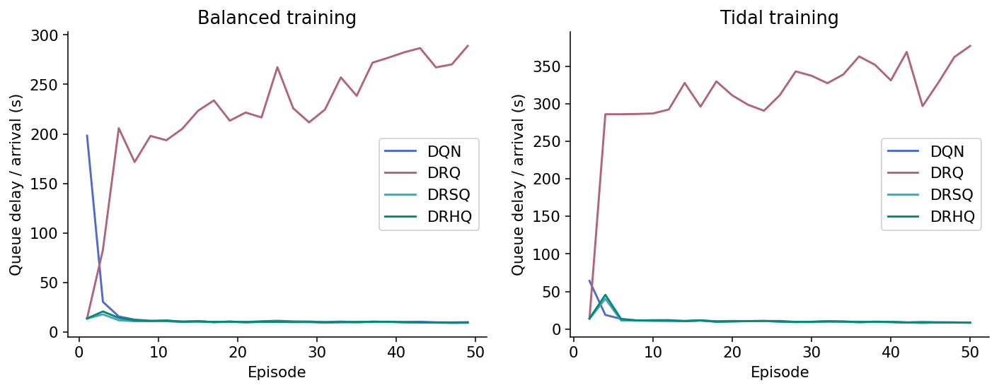
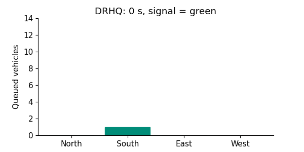

# Interpretable traffic signal control

An end-to-end CPU project for understanding DQN, DRQ, DRSQ and DRHQ from *Learning an Interpretable Traffic Signal Control Policy* (Ault, Hanna and Sharon, AAMAS 2020). Includes a readable NumPy implementation, a Colab notebook, two traffic scenarios, 13 tests, saved models, a 22-slide deck and reproducible experiment evidence.

This is a simplified algorithm demonstration. It does **not** reproduce the original SUMO/UDOT experiment or its reported 19.4% reduction. The simulator and the polynomial policy adaptations are documented in `docs/ALGORITHM.md`.

## Run in Google Colab

Upload `DRL_Group87_Colab.ipynb` at https://colab.research.google.com and choose Runtime > Run all. No GPU, SUMO installation, repository clone, account token or dataset download is needed. The notebook carries all the project code and writes it into its working folder. Its full-run preset uses three training seeds and both examples. The quick preset is only a pipeline demonstration.

The notebook displays measured comparisons, training curves, queue traces, policy explanations and an animated view. Its final cell prepares `DRL_Group87_Colab_Evidence.zip` for download. Keep your executed notebook too.

## Executed reference results

| Scenario | Actuated delay (s) | DRHQ delay (s) | Reduction |
| --- | ---: | ---: | ---: |
| Balanced | 11.688 | 9.828 | 15.92% |
| Tidal | 10.696 | 8.758 | 18.12% |

These are local synthetic-simulator measurements. See `docs/RESULTS.md` and the raw CSVs for the full comparison, failed DRQ runs and uncertainty.

## Run locally

```bash
python -m pip install -r requirements.txt
python -m unittest discover -s tests -v
python run_experiments.py
```

For a smaller first run:

```bash
python run_experiments.py --episodes 10 --seeds 11 --evaluation-runs 3
```

Results from different settings are a different experiment. The deck uses the full reference configuration. Default full execution: 50 episodes per model, seeds 11/22/33, 10 held-out arrival streams per scenario, and 1,200 simulated seconds per episode. CPU runtime depends on the machine. All learning and inference use NumPy.

## Examples

**Balanced demand:** each of four directions receives 0.30 vehicles/second on average. Use it to inspect how learned control trades queue clearance against time lost during signal changes.

**Tidal demand:** North/South receive more traffic during the first half, then East/West receive more during the second half. Use it to inspect demand reversal, phase choices and residual queues. Rates are synthetic and seeded.







## How the files fit together

| File | Purpose |
| --- | --- |
| `traffic_control/config.py` | Units and experiment settings |
| `environment.py` | FIFO queues, clearance and delay accounting |
| `networks.py` | DQN, polynomial score, Adam and analytic gradients |
| `training.py` | Replay, target network and online actor teaching |
| `evaluation.py` | Frozen rollouts, paired bootstrap and explanations |
| `visuals.py` | Figures generated from actual saved evidence |
| `run_experiments.py` | Full experiment and evidence manifest |
| `tests/test_core.py` | Mechanics, finite-difference gradients and checkpoints |
| `docs/ALGORITHM.md` | Equations, assumptions and paper mapping |
| `traffic_control/proof.py` | Extra diagnostic runs and personal evidence record |
| `docs/SCREENSHOT_GUIDE.md` | Exact screenshot locations and rubric coverage |
| `docs/VIDEO_SCRIPT.md` | 22-slide narration targeting 6:30 |
| `docs/SUBMISSION_AND_RECORDING.md` | Fresh resubmission and readable recording |

## Reading the results

`summary.csv` gives in-horizon queue delay per arrival in seconds. Lower is better. `improvement_pct` compares that metric with the local Actuated baseline: positive means lower delay, negative means worse. Baselines are local implementations, not SUMO's actuated controller. The paired confidence interval samples held-out demand streams after averaging training seeds. Read throughput and pending vehicle counts alongside the headline metric, especially for poor policies.

DRQ may perform poorly. Do not delete those rows or select only favorable seeds. Understanding why constrained score fitting can fail is part of the comparison.

The primary policy is interpretable at a fixed checkpoint. This is not a certification of safe road deployment. The simulator enforces nonconflicting movements and clearance. Real roads require richer sensing, physical models and formal safety checks.

## References and provenance

Paper: https://arxiv.org/abs/1912.11023

Authors' SUMO project: https://github.com/jault/StateStreetSumo

The implementation is original educational code prepared with coding assistance. Comments explain choices and equations without claiming unaided authorship. Reference experiment outputs were executed during preparation. For contributor proof, run and review the project yourselves and complete `docs/CONTRIBUTIONS.md` with truthful evidence.

The included reference execution records exact versions and source hashes in `results/manifest.json`. GitHub publication is your next step. No repository or Drive URL has been invented.

## Inspect a decision without retraining

```bash
python examples/inspect_decision.py --scenario tidal --second 900
python examples/custom_traffic.py --rates 0.30 0.30 0.30 0.30
python validate_results.py
```

Custom traffic is a separate experiment. Do not reuse the presentation percentages for a changed demand profile.
